<picture>
  <source media="(prefers-color-scheme: dark)" srcset="assets/header-dark.svg">
  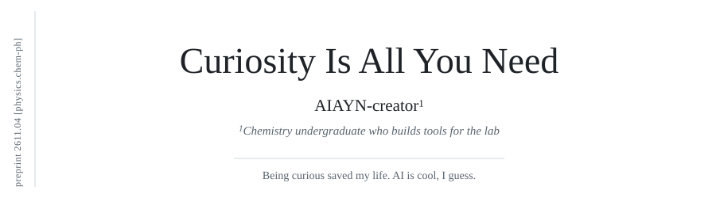
</picture>

<b>Abstract</b>

I study chemistry and write software for the parts of science nobody bothers to automate: setting up and reading quantum chemistry calculations, turning raw lab data into figures, chasing references through the literature, cleaning up handwritten notes. Lately it has spilled off the screen, into firmware and CAD for a lab robot, and into the mathematics underneath all of it. A lot of it is built together with AI agents, and a lot of it is about the same question: how to let an agent do real work while a human still decides what gets through.

**Keywords:** computational chemistry · lab automation · robotics · human-in-the-loop agents · local-first software

## 1. Results

Each project is an element, grouped by family. Click one to open it.

<a href="https://github.com/AIAYN-creator/Computational-Chemistry"><picture><source media="(prefers-color-scheme: dark)" srcset="assets/tiles/cc-dark.svg">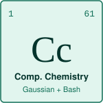</picture></a>
<a href="https://github.com/AIAYN-creator/Lab-Harness"><picture><source media="(prefers-color-scheme: dark)" srcset="assets/tiles/lh-dark.svg">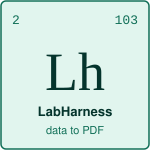</picture></a>
<a href="https://github.com/AIAYN-creator/Bib-Expres"><picture><source media="(prefers-color-scheme: dark)" srcset="assets/tiles/bx-dark.svg">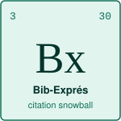</picture></a>
<a href="https://github.com/AIAYN-creator/Apuntes.md"><picture><source media="(prefers-color-scheme: dark)" srcset="assets/tiles/ap-dark.svg">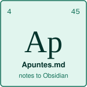</picture></a>

<a href="https://github.com/AIAYN-creator/monkey-with-a-scalpel"><picture><source media="(prefers-color-scheme: dark)" srcset="assets/tiles/ms-dark.svg">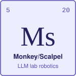</picture></a>
<a href="https://github.com/AIAYN-creator/Histos"><picture><source media="(prefers-color-scheme: dark)" srcset="assets/tiles/hs-dark.svg">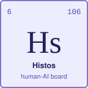</picture></a>
<a href="https://github.com/AIAYN-creator/Ego-Audit"><picture><source media="(prefers-color-scheme: dark)" srcset="assets/tiles/ea-dark.svg">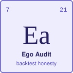</picture></a>

<a href="https://github.com/AIAYN-creator/lumen-tv"><picture><source media="(prefers-color-scheme: dark)" srcset="assets/tiles/lu-dark.svg">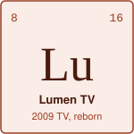</picture></a>
<a href="https://github.com/AIAYN-creator/Recetas-"><picture><source media="(prefers-color-scheme: dark)" srcset="assets/tiles/rc-dark.svg">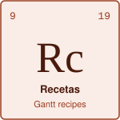</picture></a>
<a href="https://github.com/AIAYN-creator/Mi-Filmo"><picture><source media="(prefers-color-scheme: dark)" srcset="assets/tiles/mf-dark.svg">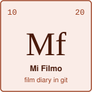</picture></a>
<a href="https://github.com/AIAYN-creator/Habit-Tracker"><picture><source media="(prefers-color-scheme: dark)" srcset="assets/tiles/ty-dark.svg">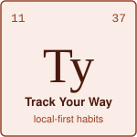</picture></a>

<picture>
  <source media="(prefers-color-scheme: dark)" srcset="assets/legend-dark.svg">
  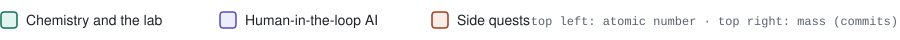
</picture>

